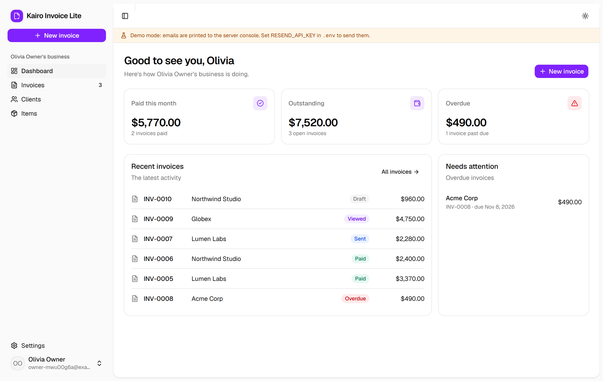
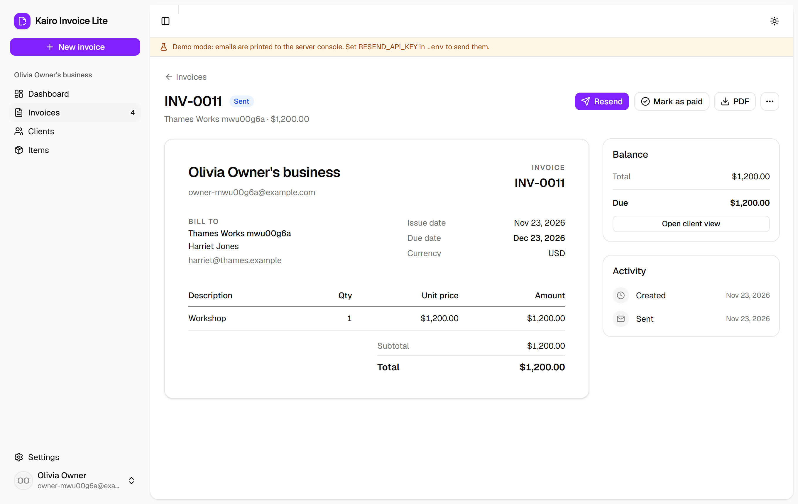
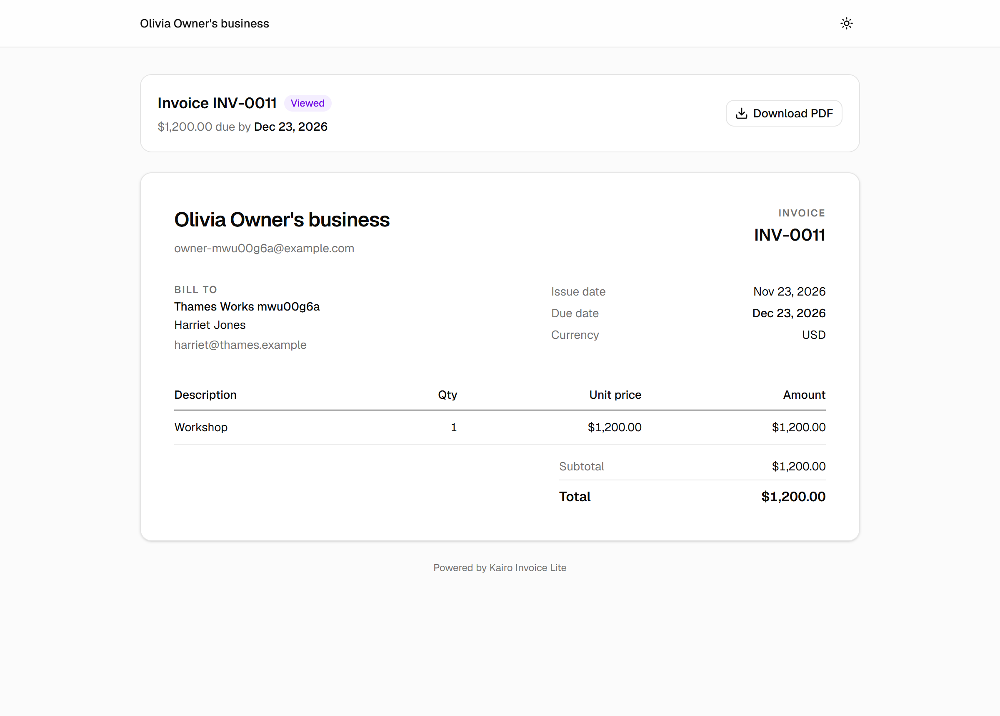

# Kairo Invoice Lite

A small, complete invoicing app you can run yourself. Create invoices from a client list and a price
catalog, email them with a PDF attached, share a link where the client can view the invoice, and see at a
glance what is paid, open or overdue.

Built with **Next.js 16**, **React 19**, **Tailwind CSS 4**, **shadcn/ui**, **Better Auth** and
**Drizzle ORM** (SQLite locally, Turso in production). MIT licensed.



| Invoice | Client view |
| --- | --- |
|  |  |

## Features

- **Invoices**: line items (pick from your catalog or type them), discount, tax, notes and payment
  details. Statuses draft, sent, viewed, paid, overdue and void; edit, duplicate, void and delete with
  the right guards
- **PDF**: rendered on the server with `@react-pdf/renderer`, the same file for downloads and email
  attachments
- **Public invoice page** (`/i/<token>`): the client views the invoice and downloads the PDF; the first
  visit marks it as viewed
- **Email**: send the invoice with React Email and Resend. Without an API key the email is printed to
  the server console, so everything works locally with zero setup
- **Mark as paid**: record a payment received by bank transfer, cash or check (and undo it)
- **Clients and items**: contact details printed on invoices, a reusable price catalog
- **Dashboard**: paid this month, outstanding, overdue and the invoices that need attention
- **Accounts**: email and password, optional Google and GitHub sign-in, one workspace per user
- **Load sample data** button to explore the app in seconds
- Light and dark theme, responsive, TypeScript throughout

Money is stored as integers in the smallest currency unit (cents) and every total is computed by one
function (`src/lib/money.ts`) shared by the form, the server, the PDF and the email.

## Quick start

Requires Node.js 20.9 or newer.

```bash
git clone https://github.com/jeffev/kairo-invoice-lite.git
cd kairo-invoice-lite
npm install
npm run dev
```

Open http://localhost:3000 and create an account. The first `npm run dev` creates `.env` from
`.env.example`, generates `BETTER_AUTH_SECRET` and creates the local SQLite database (`local.db`) with
the migrations applied. Click **Load sample data** on the dashboard to fill the workspace.

## Configuration

All variables live in `.env` (see `.env.example`).

| Variable | Required | What it does |
| --- | --- | --- |
| `BETTER_AUTH_SECRET` | yes, in production | Signs sessions. `npx @better-auth/cli secret` |
| `NEXT_PUBLIC_APP_URL` | yes, in production | Public URL used in invoice links and emails |
| `DATABASE_URL`, `DATABASE_AUTH_TOKEN` | in production | Turso database (`libsql://…`) and token |
| `RESEND_API_KEY`, `EMAIL_FROM` | no | Sends real emails; empty prints them to the console |
| `GITHUB_CLIENT_ID`, `GITHUB_CLIENT_SECRET` | no | GitHub sign-in |
| `GOOGLE_CLIENT_ID`, `GOOGLE_CLIENT_SECRET` | no | Google sign-in |

## Deploy

[](https://vercel.com/new/clone?repository-url=https%3A%2F%2Fgithub.com%2Fjeffev%2Fkairo-invoice-lite&env=BETTER_AUTH_SECRET,DATABASE_URL,DATABASE_AUTH_TOKEN&envDescription=Auth%20secret%20and%20a%20Turso%20database%20(see%20README)&envLink=https%3A%2F%2Fgithub.com%2Fjeffev%2Fkairo-invoice-lite%23deploy&project-name=kairo-invoice-lite&repository-name=kairo-invoice-lite)

1. Create a database at [turso.tech](https://turso.tech) (or with Vercel's Turso integration) and copy its
   URL and token into `DATABASE_URL` and `DATABASE_AUTH_TOKEN`.
2. Set `BETTER_AUTH_SECRET` (and `RESEND_API_KEY` to send real emails). `NEXT_PUBLIC_APP_URL` defaults
   to the Vercel production URL.
3. Apply the migrations once against that database:
   `DATABASE_URL=libsql://... DATABASE_AUTH_TOKEN=... npm run db:migrate`

On any other Node host: `npm run build && npm start` with the same variables.

## Scripts

| Command | What it does |
| --- | --- |
| `npm run dev` | Setup (`.env`, secret, migrations) and the dev server |
| `npm run build` / `npm start` | Production build and server |
| `npm run lint` / `npm run typecheck` | ESLint and TypeScript |
| `npm run db:generate` / `npm run db:migrate` | Create / apply Drizzle migrations |
| `npm run smoke` | End-to-end check in a real browser (needs a running server and Chrome) |

## Project structure

```
src/
  actions/      Server actions (clients, invoices, items, settings, sample data)
  app/          (marketing) landing, (auth) sign-in, (app) dashboard, invoices, clients, items,
                settings, (public) /i/[token], api/ auth and PDF routes
  components/   UI (shadcn/ui), invoice form, sheet and actions
  db/           Drizzle schema and Better Auth tables
  emails/       React Email templates
  lib/          Domain logic: invoices, clients, catalog, money, pdf, send, auth
drizzle/        SQL migrations
```

## Need more?

Kairo Invoice Lite covers sending invoices. The full **Kairo Invoice** adds everything around getting
paid:

| | Lite (this repo) | Kairo Invoice |
| --- | :---: | :---: |
| Invoices, clients, items, PDF, email, public invoice page | ✓ | ✓ |
| Card payments with Stripe (pay-by-link, signed webhooks) | | ✓ |
| Estimates the client accepts online, converted to invoices in one click | | ✓ |
| Deposits and partial payments | | ✓ |
| Client portal with every invoice and estimate | | ✓ |
| Multi-currency per client, reports split by currency | | ✓ |
| Recurring invoices with auto-send | | ✓ |
| Automatic overdue reminders (daily job) | | ✓ |
| Expenses, profit and tax reports | | ✓ |
| Public demo mode with daily reset | | ✓ |

[Try the full demo](https://kairo-invoice-demo.vercel.app) or
[get Kairo Invoice](https://payhip.com/b/3tacJ).

## License

[MIT](LICENSE.md) © Jefferson Valandro
